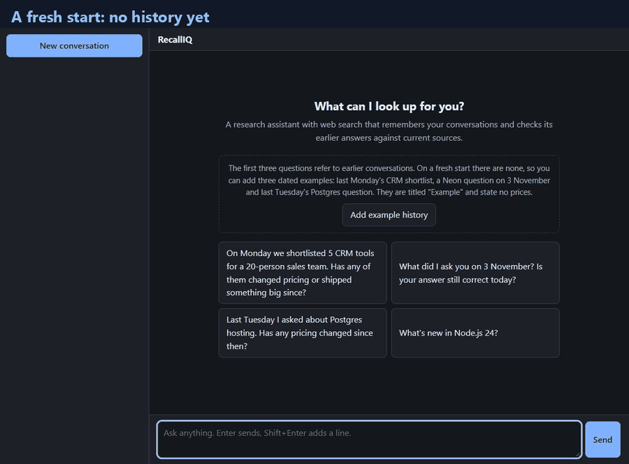

# RecallIQ

A chat agent with one tool, web search, that remembers your conversations and checks its earlier answers
against current sources. Prices and releases it states are verified by code against a verbatim quote; anything
else it says cites a source excerpt that contains every number and name in the sentence. When it cannot check
something, it says so instead of guessing.

**How it works and why:** [DESIGN.md](DESIGN.md) (one page). Decisions: [docs/adr/README.md](docs/adr/README.md).



_A real run on the free Gemini tier, recorded without edits and sped up only where nothing changed on screen
(80 s). The CRM answer is partial: some vendors' prices could not be confirmed, and it says which._

## Try it in two minutes

Needs Node.js 22 or newer. No database server: storage is one local SQLite file.

```bash
npm install
cp .env.example .env
```

In `.env`, set `APP_COMPONENTS=live`, `GEMINI_API_KEY` ([Google AI Studio](https://aistudio.google.com/apikey),
the free tier works) and `EXA_API_KEY` ([exa.ai](https://exa.ai)). Leave `GEMINI_MODEL` empty for the default.
Then:

```bash
npm run dev
```

Open <http://127.0.0.1:3001>. Without keys (`APP_COMPONENTS=scripted`, the default) the app runs with canned
answers so the interface can still be explored.

**Add the example history first.** The challenge questions refer to earlier conversations ("On Monday we
shortlisted…"), and a fresh database has none. The **Add example history** button on the start screen writes
three dated example conversations for you: last Monday's CRM shortlist, a Neon question on 3 November and last
Tuesday's Postgres question. They are titled "Example: …" and state no prices, so nothing the agent later checks
was planted. Then try:

1. _On Monday we shortlisted 5 CRM tools for a 20-person sales team. Has any of them changed pricing or shipped
   something big since?_
2. _Last Tuesday I asked about Postgres hosting. Has any pricing changed since then?_
3. _What did I ask you on 3 November? Is your answer still correct today?_
4. **The self-audit, in one sitting:** ask _What does Supabase charge for its Pro plan?_, wait for the answer,
   then ask _Is the Supabase price you gave me still correct?_ It looks up what it told you, checks the page
   again and says "no sign of a change in what I could check" (or that the value differs), comparing against its
   own verified earlier answer rather than guessing.
5. Anything current, such as _What's new in Node.js 24?_, or a follow-up to an earlier answer.

## What to look for

- **What I remembered:** the message it found for "Monday" or "3 November", quoted with its date, and the
  companies it took from it. Dates are resolved in your time zone by code, not by the model.
- **A quick sourced answer first** ("Here is what the sources say while I check the details"), then the checked
  findings per company, with numbered sources. A ✓ marks a value verified by code; a dotted underline marks a
  sentence taken from a cited source.
- **Honest gaps.** "I have no earlier prices of my own on record from before 2026-11-09, so I cannot establish
  whether anything changed" is the correct answer when the agent never answered that question itself: it does
  not invent a change from two web pages. "Couldn't be checked (the pages could not be read)" says which check
  failed and why.
- **The activity trail** above each answer: what it searched and read, and how long it took.

A pricing turn takes 20–50 s on the free Gemini tier (first text after 5–13 s); chat and memory questions take
2–4 s. Free-tier rate limits can slow or interrupt a turn; the app says so and offers a retry.

## Commands

```bash
npm run check     # typecheck, lint, format check, all tests (offline, no keys needed)
npm test          # tests only
npm run bench     # public benchmarks (FreshQA, SimpleQA, LongMemEval); see docs/benchmarks.md
```

## Documentation

- [DESIGN.md](DESIGN.md): how a turn works, why this shape, what was rejected, what was measured, next steps.
- [docs/architecture.md](docs/architecture.md) and [docs/adr/README.md](docs/adr/README.md): the full design
  and its decision records.
- [docs/running.md](docs/running.md): the three component sets (scripted, replay, live) and every setting.
- [docs/security.md](docs/security.md): threat model, prompt-injection defences, quotas.
- [docs/benchmarks.md](docs/benchmarks.md) and [docs/testing.md](docs/testing.md): how it is measured and tested.
