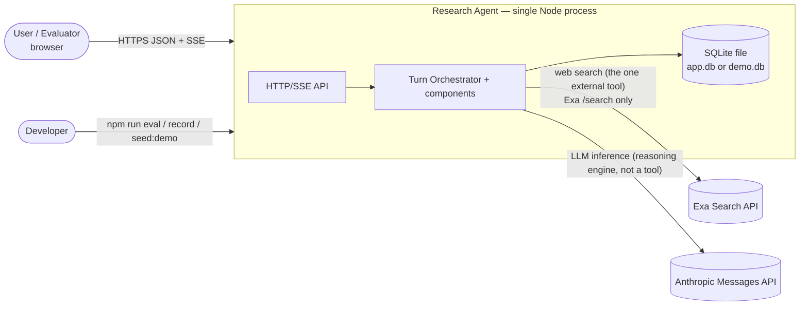
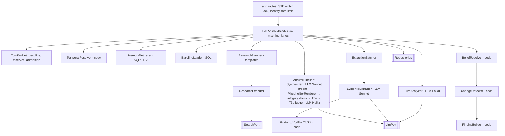
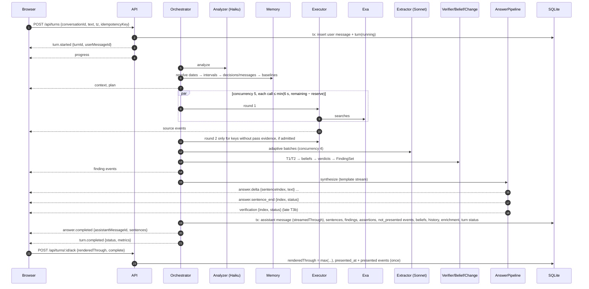
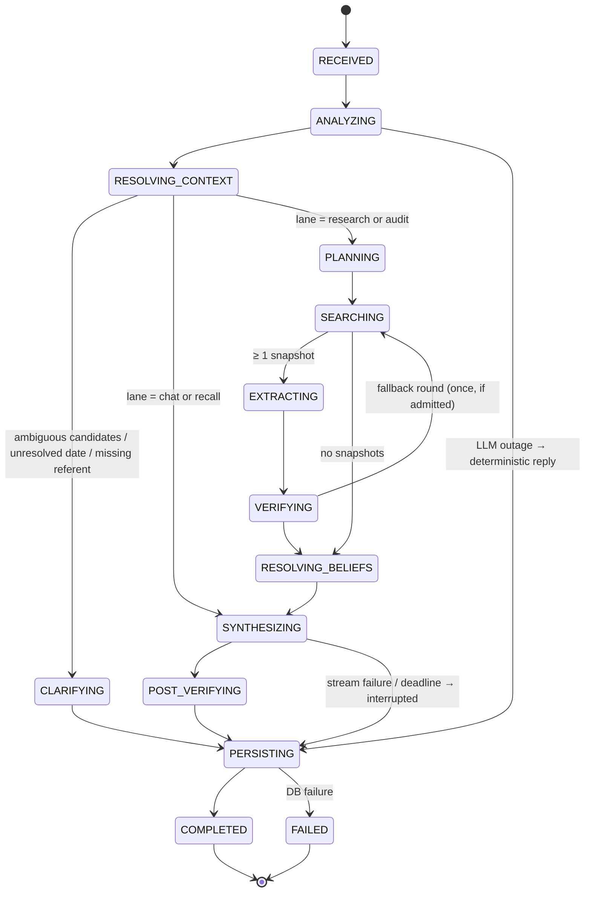
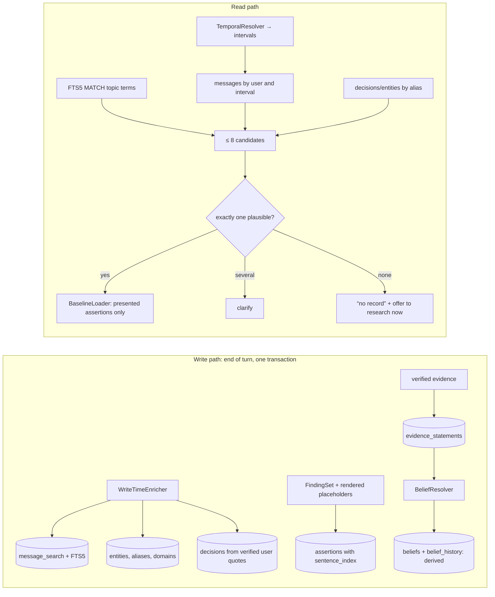
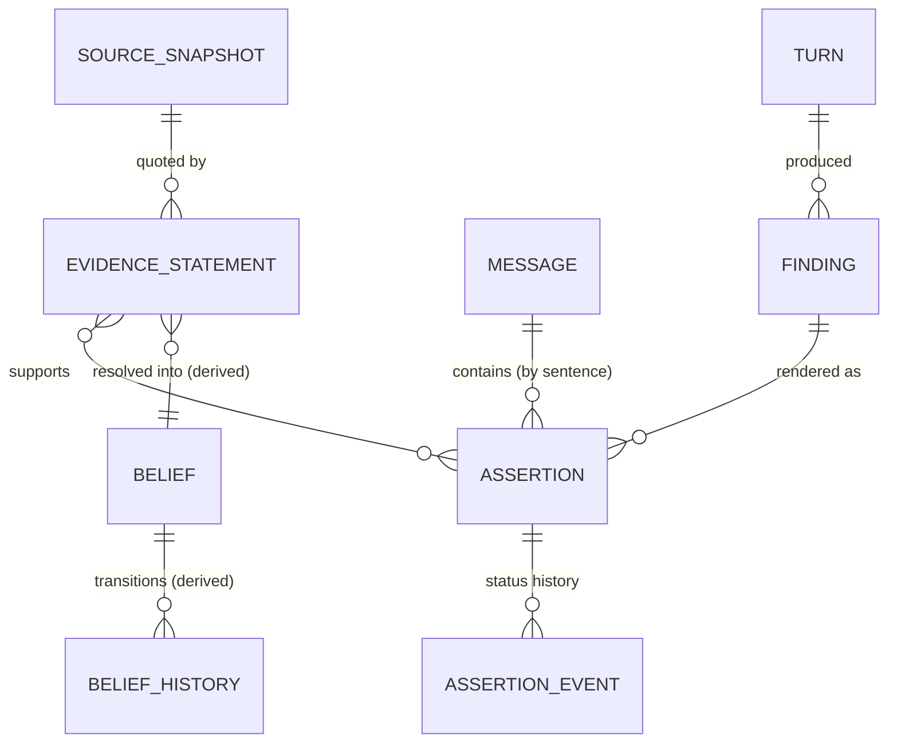
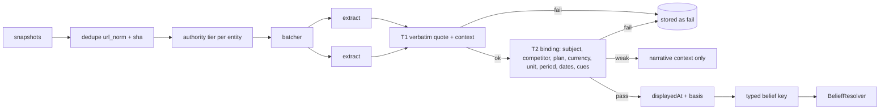
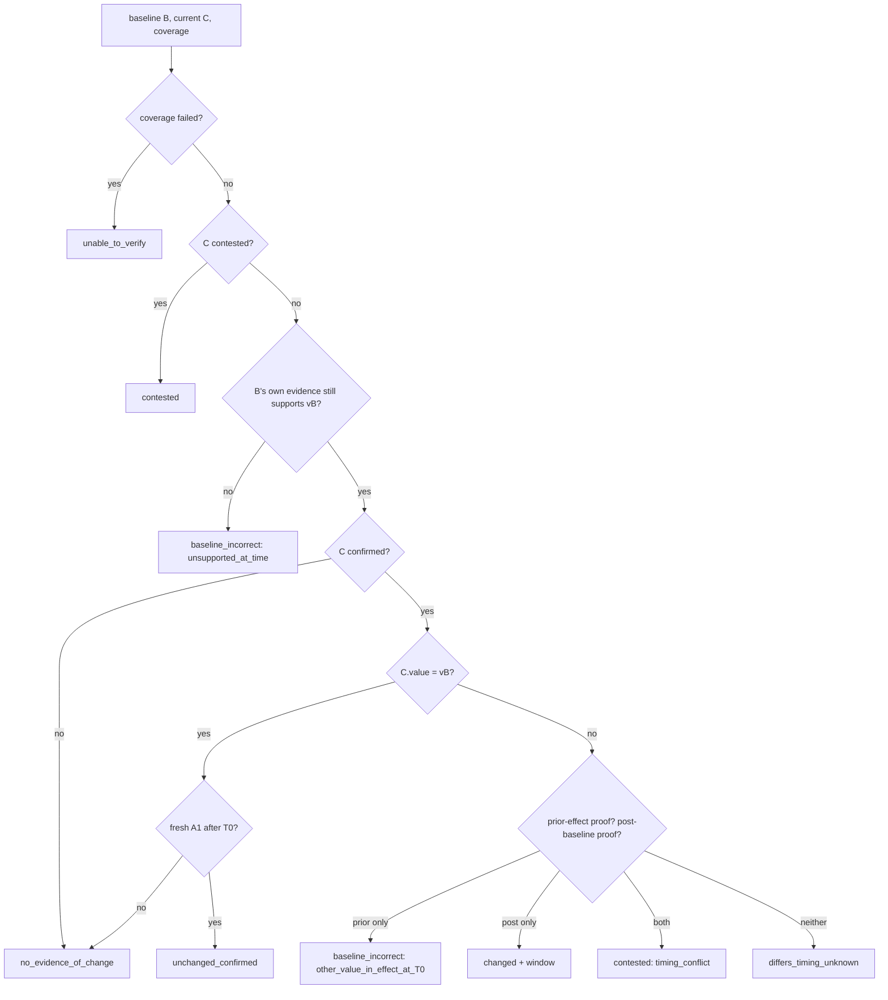

# Stage 3: Architecture Selection and System Design

**Status:** approved direction, reconciled in Stage 3.1 on 2026-11-11.
**Companion documents:**
- [contracts.md](contracts.md): SQL schema, TypeScript contracts, SSE contract. These are normative.
- [design-doc-blueprint.md](history/design-doc-blueprint.md): the plan for the final design document (historical).
- [design-review.md](history/design-review.md): the record of the first design reconciliation (historical).

The Stage 2 decisions stand: U2, U3, SQLite + FTS5, no embeddings, the four-layer claim model, Exa as provisional search provider, and Haiku + Sonnet as provisional models.

Where this document and the contracts file disagree, **the contracts file wins**, and the disagreement is a bug to fix.

---

## Part I: Cross-cutting rules

### R1. How evidence extraction is batched

**What we're deciding.** Search returns about 5–20 source snapshots across up to 6 entities. Each snapshot has to become typed, quoted evidence, which takes a Sonnet call. Latency is dominated by generating roughly 1.5k tokens of structured output. On the other side, splitting the work into more calls means repeating the system prompt in each one.

| | Option 1: one batched call | Option 2: one call per entity, in parallel | **Option 3: adaptive packing (selected)** |
|---|---|---|---|
| LLM calls for 5 entities | 1 | 5 | 2–3 |
| Input tokens | about 1.5k system + about 15k evidence | 5 × (1.5k + about 3k) ≈ 22k | about 2 × 1.5k + 15k ≈ 18k |
| Wall time [HYPOTHESIS] | about 8–15 s | about 3–5 s | about 4–7 s |
| What one failure takes down | All entities | One entity | One batch of at most 3 entities, then a per-entity retry |
| Cross-entity sources | Seen once | Duplicated per entity | Duplicated only across batches |
| Rate-limit pressure | Lowest | Highest | Bounded by a semaphore |

**Packing algorithm.** Deterministic, owned by `ExtractionBatcher`.

1. Group snapshots by the entity they were retrieved for. A snapshot can sit in several groups, but is de-duplicated within a batch.
2. Truncate each snapshot to `MAX_SNAPSHOT_CHARS = 6000`.
3. Estimate tokens as `ceil(chars / 4)`.
4. If a group exceeds `BATCH_EVIDENCE_TOKENS = 9000`, drop its lowest-ranked snapshots. Ranking is authority tier first, then fresh fetch, then provider rank.
5. Pack groups first-fit in decreasing order of size, with each batch capped at 9,000 tokens and 3 entities.

**Limits.** Each batch call uses `max_tokens = 2500`, with at most 8 statements per entity per intent. `LLM_CONCURRENCY = 4` is a process-wide semaphore. A single extraction call never runs longer than 25 s, and never longer than the turn deadline allows (§H).

**Failures.** A batch that hits 429, 5xx, timeout or invalid output is retried once, *if admission allows* (§H). If it fails again, it is split into one call per entity, again only if admission allows. An entity that still has no extraction is marked `extraction_failed` and its findings become `unable_to_verify`. One batch failing never blocks the others.

### R2. T2 relational verification

**Input.** T2 runs on the extractor's typed statement (contracts `RawEvidence`) and the snapshot text. `quote` (≤ 400 chars) and `contextQuote` (≤ 200 chars) have already passed T1, which proves both appear verbatim in the snapshot.

**Normalisation.**
- Text: NFKC, collapsed whitespace, folded quote characters.
- Numbers: `1,080` → 1080, `90.00` → 90.
- Currency: the table below.

| Marker in text | Currency | Notes |
|---|---|---|
| `US$`, `U.S.$`, `USD`, "US dollars" | USD | |
| `A$`, `AU$`, `AUD` | AUD | |
| `C$`, `CA$`, `CAD` | CAD | |
| `NZ$`, `NZD` | NZD | |
| `S$`, `SGD` | SGD | |
| `€`, `EUR` | EUR | |
| `£`, `GBP` | GBP | |
| `₹`, `INR`, `Rs.` | INR | |
| `CHF` | CHF | |
| `¥` | **unknown** | Could be JPY or CNY. Resolved only by an explicit `JPY`/`CNY` |
| bare `$` | **unknown** | Resolved **only** if the quote or the associated context contains an explicit currency declaration, e.g. "All prices in USD", "prices shown in US dollars" (rules in `evidence/currency.ts`) |

When the currency is unknown, the statement is still valid: we record that the page shows `$`, but not which dollar. Its belief key scopes the currency to the source domain (`unknown@hubspot.com`, see R3). Two bare-`$` values from the same vendor domain can then be compared, but a bare-`$` value from a different site can never be merged with them. The displayed symbol is kept (`currencySymbol: "$"`), and the renderer adds "(currency not stated)".

**Segmentation and association.**
- The quote is split into segments at newlines, table cell separators (`|`, tab), bullet markers and sentence boundaries.
- An "associated header" is a `contextQuote` that **(a)** appears in the snapshot text *before* the quote and within 1,500 characters of it, and **(b)** has no other heading-like line (markdown `#`, a table header row, or a line in Title Case under 80 characters) that names a different entity between it and the quote.
- Position checks are done by code on the snapshot text.

**Rules.** Every rule is owned by `EvidenceVerifier`, and each one has positive and negative tests (§17).

| Check | Pass condition | Weak | Fail |
|---|---|---|---|
| **Subject binding** | An alias of the entity appears in the value's segment, **or** in the associated header. **The snapshot title, URL and domain never establish the subject.** | The only subject signal is the official domain, or the header association can't be established | The value's nearest entity alias is a different entity (see next row) |
| **Competitor attribution** | Within the segment and header, the closest entity alias before the value (by token distance) is our entity, with no other known entity alias in between. "Known entity aliases" means the turn's entity set plus any capitalised product names in the same segment that match an alias in the user's entity table | Two aliases are equally close | The closest alias is another entity |
| **Plan / tier binding** | The normalised plan appears in the value's segment or the associated header, and no other known plan of the same entity sits between that plan and the value | Plan only found in a header that is more than one table-row level away | Another plan sits between them (the intervening-tier rule) |
| **Value presence** | The normalised amount is in the segment | — | Absent |
| **Currency** | The extracted `currency` equals the currency the marker table resolves to, or both are `unknown` | — | Mismatch, including extracted `USD` from a bare `$` with no declaration |
| **Unit** | `per_seat` needs a marker: `/user`, `per user`, `/seat`, `per seat`, `per member`, `per agent`, `per license`. `flat` needs a **positive** marker: `flat fee`, `flat rate`, `per account`, `per organization`/`org`, `per workspace`, `per team`, `unlimited users`, `for your whole team`. `usage` needs a metered marker (`per GB`, `/GB-month`, `per hour`, `per 1,000/1M <noun>`, `per request`, `per vCPU`, `per compute hour`) **and** the extracted `usageUnit` text must appear in the segment. Otherwise the unit must be `unspecified` | — | A unit was claimed without its marker, or the absence of seat language was treated as `flat` |
| **Billing period** | `monthly` needs `/mo`, `per month`, `monthly`. `annual` needs `/yr`, `per year`, `annually`, `yearly`. `monthly_billed_annually` needs both a monthly marker and `billed annually` / `paid yearly`. Otherwise `unspecified` | — | The text contradicts the claimed period |
| **Effective / event date** | Set only if a date expression in the quote or header parses to the same day (or month, if that's all it gives). Otherwise null | Only a month or a year is given, and the claim needs a day | Invented date |
| **Negation** | Cues within 6 tokens before the value or feature (`no longer`, `not`, `discontinued`, `removed`, `deprecated`, `retired`, `sunset`) require `polarity = negated` | — | Polarity mismatch |
| **Historical cue** | `was`, `previously`, `formerly`, `old price`, `used to`, or strikethrough markup (`~~`) bound to the value require `modality = historical` | — | Mismatch |
| **Conditionality** | `starting at`, `from`, `as low as` require `valueKind = lower_bound`. `up to` requires `upper_bound`. `if`, `when`, `for teams of`, `with annual commitment`, `minimum` require `modality = conditional` and a non-empty `conditions`. `promo`, `discount`, `first year`, `limited time`, `% off` require `promotional` | — | Mismatch |
| **Planned** | `will`, `starting <date>`, `effective <future date>`, `coming soon` require `modality = planned` and an `effectiveFrom` | Future cue with no parseable date: weak, and kept out of beliefs | Mismatch |

**Outcome.**
- `pass` means every applicable check passed.
- `weak` means at least one check is weak and none failed.
- `fail` means any check failed.

Only `pass` statements can feed beliefs, prices or change verdicts. `weak` statements reach the synthesizer only as narrative context, and are always labelled "unconfirmed".

**Known cost** [HYPOTHESIS, to measure in Phase 4]. The bare-`$` and subject-binding rules will push more vendor pricing statements to `weak` or currency-unknown. We accept that: under-claiming is better than misattributing. The bake-off measures the actual weak rate (U15).

### R3. Belief keys, time and belief resolution

#### Time fields

These fields are kept separate. The full list is in the contracts §2 `TimeFields`.

| Field | Owner | Meaning | What it does **not** mean |
|---|---|---|---|
| `observedAt` (snapshot) | ResearchExecutor | When we retrieved the source | When the content was written |
| `freshFetch` (snapshot) | Search adapter | The provider fetched the page live for this request and the crawl succeeded | — |
| `providerPublishedAt`, `providerLastUpdatedAt` (snapshot) | Search adapter | Provider metadata. Provenance is the `provider` column. These are hints | Ground truth |
| `effectiveFrom` (evidence) | Extractor + T2 | The date the text says the fact took or takes effect | When we saw it |
| `eventDate` (evidence, releases) | Extractor + T2 | The date the text says the event happened | Publication date |
| `displayedAt` + `displayedAtBasis` (evidence, derived by code) | EvidenceVerifier | The latest instant at which we can show the source displayed this statement | When the fact first became true |
| `presentedAt` (assertion) | Ack handler | When the user's client rendered the sentence containing our claim | When we generated it |

`displayedAt` is derived from the first rule that applies:

| Condition | `displayedAt` | Basis |
|---|---|---|
| `freshFetch` | `observedAt` | `fresh_fetch` |
| Otherwise, `providerLastUpdatedAt` exists | That value | `provider_last_updated` |
| Otherwise, `providerPublishedAt` exists | That value | `provider_published` |
| Otherwise | null | `unknown` |

`effectiveFrom` is never substituted for `displayedAt`. **A fresh fetch proves what the page showed at `observedAt`. It doesn't prove when that value started.**

#### Typed belief key (contracts `PriceBeliefKey`)

| Field | Values | Why it's in the key |
|---|---|---|
| `entityId` | — | Subject |
| `plan` | normalised plan, or `unspecified` | Tiers are separate prices |
| `arrangement` | `list` · `conditional` · `promotional` · `planned` | So promo, conditional and future prices never overwrite the list price |
| `conditionHash` | sha1 of normalised `conditions` text for `conditional` / `promotional`, otherwise `-` | Two different promotions are two keys |
| `unit` | `per_seat` · `flat` · `usage` · `unspecified` | |
| `usageUnit` | normalised (e.g. `gb-month`) for `usage`, otherwise `-` | |
| `billingPeriod` | `monthly` · `annual` · `monthly_billed_annually` · `one_time` · `unspecified` | Monthly and annual are different prices, not a conflict |
| `currency` | ISO 4217, or `unknown@<registrable domain>` | See R2 |
| `locale` | canonical BCP-47 (for example `en-GB`), or `und` | The same plan costs different amounts in different regions; derived by code from the URL (ADR-37) |
| `valueKind` | `exact` · `lower_bound` · `upper_bound` | "from $20" and "$20" are not compared |

**Canonical encoding.** Field order is fixed, the format is versioned, and it is produced by a single function `encodePriceKey` in `belief/belief-key.ts`:

```
price:v1|e=ent_7|p=professional|a=list|c=-|u=per_seat|uu=-|b=monthly_billed_annually|cur=USD|loc=en-US|vk=exact
```

**Mapping a statement to a key:**

| Statement | Key |
|---|---|
| `modality = current` | `arrangement = list` |
| `conditional` | `arrangement = conditional` |
| `promotional` | `arrangement = promotional` |
| `planned` | `arrangement = planned` |
| `historical` | **No belief key.** Stored as evidence only, and usable as context by `ChangeDetector` (§8) |
| `polarity = negated` | No price key. Recorded as a `plan_change` event |

Release facts use `release:v1|e=<id>|t=<sha1(normalised title)>`. They form an event log, not single-valued beliefs.

**Planned prices never become current on their own.**
- A `planned` statement stays under its `planned` key.
- Once `now ≥ effectiveFrom`, the resolver attaches it to the matching `list` key as a `pendingSignal`, e.g. "announced to change to $X on <date>; not yet observed on the pricing page".
- It can never change the list key's value or status. Only an observation of the list price can.

**Comparable keys.** Change detection compares exact keys only. If a baseline key has no exact current counterpart but a *comparable* one does exist (differing only where one side is `unspecified`, `unknown@…` or a different `valueKind`), the verdict is `no_evidence_of_change`, with `note = listed_differently` and both listings shown.

#### Belief resolution (pure, owned by `BeliefResolver`)

**Inputs.** Every `pass` statement for one key, for this user, plus the previous belief.

**Authority tiers** (unchanged from Stage 3):

| Tier | Source |
|---|---|
| A1 | Official pricing or product page |
| A2 | Official announcement, or other official path |
| B | Curated reputable secondary source |
| C | Anything else |

`official_domains` come from three places:
- a name match on the registrable domain;
- the analysis guess, accepted only if it appears in the entity's search results;
- the user.

```
resolve(key, S_all, prev, now, policy):
  S = S_all.filter(pass ∧ polarity = affirmed)                  // statements already mapped to this key
  if S empty: status = prev ? STALE : UNKNOWN; value = prev?.value
  current(s) = s.displayedAt ≠ null ∧ now − s.displayedAt ≤ policy.freshness[attr]   // price: 30 d
  F = S.filter(current)
  if F empty:
      w = the max-tier item in S, then latest displayedAt (nulls last)
      status = STALE; value = w.value; displayedAt = w.displayedAt
  else:
      T   = the highest tier present in F
      top = F.filter(tier = T), sorted by displayedAt desc
      near = top.filter(top[0].displayedAt − displayedAt ≤ policy.contestWindow)      // 7 d
      if distinct(near.value).size > 1: status = CONTESTED; contestedValues = group(near)
      else: status = CONFIRMED; value = top[0].value; displayedAt = top[0].displayedAt
      lower = F.filter(tier < T ∧ displayedAt − top[0].displayedAt > policy.lowerTierLead ∧ value ≠ top[0].value)   // 2 d
      if lower nonempty: pendingSignal = newest(lower)          // never changes the value
  for list keys: attach due planned signals (planned.effectiveFrom ≤ now) as pendingSignal
  verifiedAt = max displayedAt among winners whose basis = fresh_fetch, else null
```

**Transitions** (recorded in `belief_history.reason`):

| Reason | When |
|---|---|
| `initial` | First belief for the key |
| `reconfirmed` | Same value, newer `displayedAt` |
| `world_changed` | The value differs **and** the new winner's `displayedAt` > the previous winner's `displayedAt`. Here this means only "the record we hold changed". It is *not* a claim about the world; the user-facing verdict is decided by §8 |
| `corrected` | The previous winner no longer passes (re-verification under current rules), or a same-or-higher-tier statement with `displayedAt ≤` the previous `displayedAt` contradicts it |
| `contested` | Status became CONTESTED |
| `staled` | Status became STALE |

**Rebuild.** `beliefs` and `belief_history` are both derived. `rebuildBeliefs(userId)` deletes and recomputes both by replaying `pass` evidence in `(displayedAt nulls first, created_at)` order. This is tested to produce the same output as incremental updates (T-DB-REBUILD).

### R4. Streaming, verification and delivery

**The principle stays the same: the LLM writes the narrative, and code writes the facts.**

1. **Findings are computed first.** They are deterministic, and are emitted as `finding` events carrying `currentStatus` and (for audits) `verdict`. Before that point, only `progress` and `source` events are sent, and neither carries claims.
2. **Synthesis output is a template.** Web facts and historical records may only appear as placeholders (grammar in contracts §3).
3. **The pipeline per sentence** (owned by `AnswerPipeline`):
   1. **Template accumulation and parsing.**
      - The renderer buffers raw deltas. Any opening `[[` is held until its `]]` arrives, for at most 64 characters.
      - Sentence boundaries are detected on the **template**. Placeholders are opaque tokens, so a decimal inside a rendered price never splits a sentence.
   2. **Malformed or unknown placeholders.**
      - Grammar mismatches, unclosed `[[` after 64 characters, IDs not in the authorised set, and variants that don't apply (e.g. `:baseline` on a finding with no baseline) are **removed from the output**.
      - The sentence gets `issues += malformed_placeholder | unknown_ref`.
   3. **Render.** Each valid placeholder is replaced with `render(record)`. The authorised set is:
      - this turn's `FindingSet`;
      - the reused `FindingSet` (chat lane);
      - recall records in `ResolvedContext`.
   4. **Render-integrity check** (deterministic). For every rendered placeholder, assert that `renderedText === render(authorisedRecord)` and that `record.id ∈ authorisedSet`. A failure is a renderer bug: the sentence is flagged `render_mismatch` and an error is logged.
   5. **T3a free-text check, on the template with valid placeholders removed** (deterministic). Numbers inside rendered placeholders are therefore never seen as free text. The check flags each of the following:
      - A currency amount or symbol followed by a number.
      - A percentage.
      - A number with a unit or quantity noun, unless it is in the **allowlist**. The allowlist is: numerals appearing verbatim in the current user message (e.g. "20 seats"), and list markers at the start of a line.
      - An explicit calendar date (day + month, or month + year), unless it equals the local date of a resolved interval in `ResolvedContext`.
      - A verdict word (`raised`, `increased`, `cut`, `lowered`, `reduced`, `unchanged`, `no change`, `same price`, `launched`, `released`, `shipped`, `discontinued`, `removed`), unless the sentence also contains a `[[F…]]` whose verdict is in that word's compatible set (contracts §3).
      - A global negative claim ("none of them", "no changes", "nothing changed"), unless **every** finding in the FindingSet has a verdict compatible with "no change" **and** no finding is `unable_to_verify`.
   6. **T3b judge** (Haiku, batched, off the critical path). It runs only for sentences that pass T3a and contain at least two finding placeholders together with a comparative word (`cheaper`, `more expensive`, `best`, `only`, `most`, `least`, `than`).
4. **Sentence statuses.** The `pending` state is client-side only.

| Status | Meaning |
|---|---|
| `verified` | Contains at least one placeholder, and T3a passed (plus T3b, if it applied) |
| `no_claims` | T3a passed and there are no placeholders. Narrative only |
| `unverified` | T3a, T3b, the integrity check or a placeholder issue flagged it. `issues[]` says which (contracts `SentenceIssue`) |
| `unchecked` | Needed T3b, but no result arrived before the deadline or the judge failed |
| `truncated` | The last, incomplete sentence of an interrupted stream |

5. **Timing.** *(Revised 2026-11-12, [ADR-40](adr/ADR-40.md): factual sentences are released only after validation. The previous text, which streamed every sentence immediately and let late checks downgrade it, is kept below as history. Where they differ, this item wins.)*
   - There are three states: **received** (model text held in the pipeline, never sent or stored), **validated** (passed placeholder authorisation, rendering, the render-integrity check, T3a and, where it applies, T3b) and **presented** (acknowledged as rendered by the browser).
   - The unit of release is the sentence. A validated sentence is sent as one `answer.delta` with its complete rendered text, then `answer.sentence_end` with its final status. A sentence that fails a check, or needs T3b and gets no result within the cap, is **withheld**: not sent, not stored, no index consumed, and a `warning sentence_withheld` names the issues. An interrupted stream never sends its incomplete trailing sentence.
   - `pending_judge` and the later `verification` event remain in the contract only for a defect found after release; they should not occur in normal operation.

   *Previous text (superseded): how verification arriving after the sentence had streamed was handled.*
   - Sentence text streams immediately. **There is no hold-back.** This is safe because high-risk facts can only enter the text through placeholders that were verified beforehand.
   - The server emits `answer.sentence_end {index, status}` as soon as a sentence completes. The status is the T3a result, or `pending_judge`.
   - If T3b is still needed, a `verification {index, status, issues}` event follows later.
   - The client restyles that sentence in place when the event arrives. Until then it shows a subtle "checking" marker. Late results always *downgrade or confirm* a sentence; they never upgrade an `unverified` one.
   - `answer.completed` is emitted only after every sentence has a final status.
6. **Persisted status on interruption.**

| Situation | Persisted sentence statuses |
|---|---|
| Synthesis stream fails | Completed sentences keep their final status, or `unchecked` if T3b was pending. The partial trailing sentence is persisted as `truncated`. Message status is `interrupted` |
| T3b fails or misses the deadline | Affected sentences become `unchecked`. Message status is `complete` |
| Process crash | Recovery marks the turn `interrupted`. No assistant message is persisted (none was committed). Streamed text that wasn't persisted is lost, and the client shows "answer interrupted" (known limitation L-12) |

**Delivery boundary** (owned by the ack handler). The **unit of acknowledgement is the sentence.**

- **Server side.** The server tracks `streamedThrough`, the highest sentence index whose final delta was written to the SSE socket. It is persisted with the message.
- **Client side.** The client calls `POST /api/turns/:turnId/ack {renderedThrough, complete}`:
  - when `answer.completed` has been rendered;
  - on `pagehide` / `visibilitychange` (via `navigator.sendBeacon`), with the highest fully rendered sentence index;
  - after re-rendering a persisted message on reconnect.
- **Idempotency.** The server stores `renderedThrough = max(stored, request)` (it is monotonic). Every assertion with `sentenceIndex ≤ renderedThrough` and no `presented_at` gets `presented_at = now` and **one** `presented` event, enforced by a partial unique index. Repeated or out-of-order acks are no-ops.
- **Delivery state of an assertion** (derived, never stored separately):

| State | Condition | Used for |
|---|---|---|
| `presented` | `sentenceIndex ≤ renderedThrough` | Recall says "I told you…". Eligible as a baseline |
| `streamed_unacknowledged` | `renderedThrough < sentenceIndex ≤ streamedThrough` | Recall says "I started telling you … you may not have seen it". **Not** a baseline |
| `not_streamed` | `sentenceIndex > streamedThrough` | Never mentioned as told. Gets a `not_presented` event at persist time |

- **Partial display is represented accurately.** If sentences 0–3 were acked before a disconnect, those assertions are `presented` and the rest are not.

### R5. Evaluation data classes

This is unchanged from Stage 3.

| Class | Identification | Use |
|---|---|---|
| **Recorded** | `origin = 'recorded'`, manifest with git SHA, model IDs, `recorded_at` | Demo history, offline regression |
| **Synthetic** | `origin = 'synthetic'`, fictional names, `.example` domains, `[SYNTHETIC]` titles | Edge-case regression |
| **Live** | Results under `eval/results/live/<date>/`, never imported | Invariant-graded checks against real APIs |

**Replay** (`ReplaySearch`, `ReplayLlm`) is keyed by request hash.
- A miss throws `ReplayMissError`.
- Replay adapters are constructed **without** credentials and without a live fallback.
- In replay mode, the composition root asserts that no live adapter exists (T-EVAL-01, T-EVAL-02).

### H. Deadline propagation

There is one absolute deadline per turn: `deadline = startedAt + TURN_DEADLINE_MS` (60,000 ms). It is owned by `TurnBudget`. Every external call inherits it.

1. **The turn signal.** A `turnController: AbortController` is aborted at `deadline` (a timer) or when the server shuts down. **A client disconnect does not abort it** (ADR-17).
2. **Per-call timeout.** Each call gets `timeoutMs = min(callCap, budget.remaining() − reserveFor(stage))`. The call signal is `AbortSignal.any([turnSignal, AbortSignal.timeout(timeoutMs)])`. Per-call caps are upper bounds:

   | Call | Cap |
   |---|---|
   | Search | 6 s (live crawl ≤ 5 s inside it) |
   | Analysis | 8 s |
   | Extraction | 25 s |
   | Judge | 4 s |
   | Synthesis | Until the deadline |

3. **Reserves.** Time is set aside for the stages still to come:

   | Stage starting | Reserve |
   |---|---|
   | Search | 12 s for synthesis + 1 s for persistence |
   | Extraction | 10 s |
   | Judge | Must finish by `deadline − 500 ms` |

4. **Admission.** A retry, extraction split, fallback round or judge call **starts only if** `budget.remaining() − reserveFor(stage) ≥ minDuration(op)`:

   | Operation | `minDuration` |
   |---|---|
   | Search retry | 2 s |
   | Extraction retry or split | 8 s |
   | Fallback round | 15 s |
   | Judge | 2 s |

   If an operation is not admitted, its outcome is `failed` with code `deadline`, recorded in coverage. **No operation extends the deadline.**
5. **Synthesis.** If less than 12 s remains at entry, synthesis runs in compact mode (`max_tokens = 600`, findings only) and a `warning: deadline_compacted` is emitted. If the deadline fires mid-stream, the stream is aborted and the turn ends `interrupted` as described in R4.6.
6. **Cancellation.**
   - Aborted searches and LLM calls reject with `cancelled`.
   - Their keys go to `unable_to_verify` with reason `deadline`.
   - Persistence is local and fast, so it runs *after* the deadline if needed. It is the only work allowed past it.

---

## Part II: Candidate architectures and selection

This part is unchanged from Stage 3. Four options were scored:

| Option | Weighted score |
|---|---|
| A: single agent | 48.6 |
| D: guarded agent | 66.0 |
| B: single pipeline | 75.8 |
| **C: hybrid pipeline with routed lanes (selected)** | **90.6** |

Weights: correctness 15, citation integrity 12, temporal 12, historical 10, research 10, reliability 8, testability 8, latency 7, debuggability 5, explainability 5, complexity 4, tokens 2, searches 2.

- **Why A and D lost.** Their control flow is non-deterministic, so replay testing is brittle. They make 8–15 sequential LLM calls on a multi-entity audit, and their guarantees depend on prompts.
- **Why B lost.** It runs one pipeline for every turn, so memory is a side input and every chit-chat turn pays the full research cost.
- **What C costs.** It has more modules than B.

| Criterion (weight) | A | B | **C** | D |
|---|---|---|---|---|
| Correctness (15) | 2 | 4 | **5** | 3 |
| Citation integrity (12) | 2 | 4 | **5** | 4 |
| Temporal reasoning (12) | 2 | 4 | **5** | 3 |
| Historical retrieval (10) | 3 | 3 | **5** | 4 |
| Research quality (10) | 4 | 3 | **4** | 4 |
| Reliability (8) | 2 | 4 | **4** | 3 |
| Testability (8) | 2 | 4 | **5** | 3 |
| Latency (7) | 2 | 3 | **4** | 3 |
| Debuggability (5) | 2 | 5 | **4** | 3 |
| Explainability (5) | 3 | 5 | **4** | 3 |
| Simplicity (4) | 4 | 4 | **3** | 3 |
| Token use (2) | 2 | 3 | **4** | 2 |
| Search use (2) | 2 | 3 | **4** | 3 |
| **Weighted total** | 48.6 | 75.8 | **90.6** | 66.0 |

**Sensitivity.** C stays ahead of B unless complexity carries more than about 45% of the weight. It stays ahead of A/D unless adaptive research alone carries more than about 40%.

**Deployment.** C runs as a modular monolith: one Node process, SQLite in-process, and the Vite dev server for the UI. Every boundary is a TypeScript module.

**Reconsider if** the system ever needs multiple writer processes, or needs to scale research workers independently.

---

## Part III: Detailed design

### 1. System context



**Trust boundaries.** The browser is untrusted input. Exa content is untrusted data. LLM output is checked. SQLite is trusted storage.

### 2. Components



| Component | Input → Output | Kind | Failure behaviour | Tests |
|---|---|---|---|---|
| API | HTTP → SSE / JSON | Code | 4xx on invalid input; 409 if a turn is already running; 429 when rate-limited; ack is idempotent | Route, SSE framing, idempotency, ack monotonicity |
| TurnOrchestrator | `TurnRequest` → `TurnResult` + events | Code | Never throws to the API; degrades according to §14 | State-transition table, replay scenarios |
| TurnBudget | clock, deadline → `remaining`, `signalFor`, `admit` | Code | — | Unit with FixedClock |
| TurnAnalyzer | message, window, digest → `TurnAnalysis` | LLM | Retries once if admitted, then falls back to heuristics (`degraded`) | Replay goldens, fallback |
| TemporalResolver | mentions, tz, now → `ResolvedTemporal[]` | Code | `unresolved` sends the turn to clarify | Exhaustive table |
| MemoryRetriever | intervals, terms, entities → candidates, decisions | Code | DB error → `failed` ("memory unavailable"); never guesses | Seeded DB |
| BaselineLoader | turn IDs, entity IDs → `Baseline[]` (presented assertions only) | Code | Missing evidence → `evidenceStatusAtT0 = missing` | Fixtures |
| WriteTimeEnricher | committed turn → search rows, tags, aliases, decisions | Code | Runs inside the persist transaction | Unit |
| ResearchPlanner | context, analysis → `ResearchPlan` | Code | — | Plan snapshots |
| ResearchExecutor | plan, budget → outcomes, snapshots | Search | Per-query isolation; retries only if admitted | Replay, fault injection |
| AuthorityClassifier | snapshot, entity domains → tier | Code | — | Table |
| ExtractionBatcher | snapshots by entity → batches | Code | — | Property |
| EvidenceExtractor | batch → `RawEvidence[]` | LLM | Retry → split (if admitted) → `extraction_failed` | Replay, adversarial pages |
| EvidenceVerifier | raw, snapshot, entity context → `VerifiedEvidence` | Code (pure) | — | ≥ 100 table cases (§17) |
| BeliefResolver | key, statements, prev, now → resolution | Code (pure) | — | Property + table |
| ChangeDetector | baseline, belief, evidence, coverage → verdict | Code (pure) | — | Verdict table |
| FindingBuilder | beliefs, verdicts, coverage, constraints → `FindingSet` (including code-computed `derived` values) | Code | — | Unit |
| AnswerPipeline | FindingSet, recall, window → rendered stream + sentence statuses + assertions | LLM + code | §R4.6 | Renderer, T3a, integrity, interruption |
| Repositories | commands → rows | Code | Typed errors; owner checks | Integration |

None of these components is a separately deployed service.

### 3. Request lifecycle (heavy `audit` turn)



### 4. State machine



**Budgets.**

| Item | Limit |
|---|---|
| Deadline | 60 s (§H) |
| Searches per turn | ≤ 16 |
| Searches per entity | ≤ 4 |
| Entities per turn | ≤ 6 (beyond that: "first 6, say so") |
| Fallback round | Only if admitted |
| Judge | Only if admitted |

**Turn statuses.** Contracts `TurnStatus`. The persisted `turns.status` uses the same values; `TerminalTurnStatus` excludes `running`.

| Status | Meaning |
|---|---|
| `running` | Persisted only while in progress |
| `complete` | The turn finished with no coverage failures |
| `partial` | At least one key is `unable_to_verify` because of a failure or the deadline |
| `clarify` | The turn ended in a clarifying question |
| `interrupted` | The synthesis stream or the process died |
| `failed` | Nothing could be answered |

**Lanes.** The orchestrator decides the lane. The `laneHint` from analysis is advisory only.

| Lane | LLM calls | Searches |
|---|---|---|
| `chat` (includes follow-ups that reuse a FindingSet) | 2 | 0 |
| `recall` | 2 | 0 |
| `research` | 3–6, plus an optional judge | 2–16 |
| `audit` | 3–6, plus an optional judge | 2–16 |
| `clarify` | 1 | 0 |

**Lane rules:**
- `recall` + `asksStillCorrect` → `audit`.
- `research` with no entities and no queries → `chat`.
- Any referent that can't be resolved → `clarify`.

### 5. Memory retrieval and persistence



**What counts as "plausible"** (U3, confirmed):
- **With topic terms:** a conversation in the interval with an FTS match. If exactly one matches, it is used and the date it was resolved to is stated. If more than one matches, the agent asks.
- **Without topic terms** ("what did I ask on 3 Nov?"): every user message in the interval is listed. No disambiguation is needed.
- **For `last <weekday>`:** the same rules apply across both candidate days.

**Context sent to the LLM:**
- the last 6 messages, each truncated to 1,500 characters;
- a digest of at most 600 tokens: active decisions, the 10 most recent entities, and constraints;
- the retrieved records.

**Decisions** come only from user messages. Each one must carry a verbatim quote from that message, checked by a T1-style substring test.

### 6. The four-layer claim model



| Layer | Table | Mutability (enforced by triggers, contracts §1) |
|---|---|---|
| L1 | `source_snapshots` | No UPDATE. DELETE only through the privacy-deletion procedure |
| L2 | `evidence_statements` | No UPDATE |
| L3 | `assertions` + `assertion_events` | `assertions`: only `presented_at` NULL → value. `assertion_events`: no UPDATE |
| L4 | `beliefs` + `belief_history` | Derived. Fully rebuildable |

### 7. Evidence pipeline



**Extraction prompt contract.**
- Fixed, cached system prompt.
- Sources are wrapped in `<source id="S4" domain="…" tier="…" observed="…" fresh="…">` blocks.
- Quotes must be exact, and `contextQuote` must be the nearest heading or table header *above* the quote.
- No inference of absent fields; `currency` must be `unknown` unless explicitly marked.
- The output schema has no fields for instructions.

**Pricing intents request full text, not highlights.** For pricing intents, `SearchRequest.contentMode = 'text'`, so headings and table structure survive for association. Release intents use highlights.

### 8. Temporal reasoning and change detection

**Temporal resolution rules** (unchanged; owned by `TemporalResolver`):
- Each weekday, date or relative expression maps to local-day intervals in the user's timezone, computed with Luxon.
- `last <weekday>` gives two candidates.
- A bare `<day> <month>` resolves to the most recent past occurrence.
- `this <weekday>` in the future is ambiguous, so the agent asks.

**Price verdicts** (owned by `ChangeDetector`). The baseline B has key `kB`, value `vB`, `T0 = B.presentedAt`, and its own evidence `EB` with `displayedAt_B` and tier `tier_B`. The current state C is the belief for exactly `kB`. Evaluate in order; **the first match wins**:

| # | Condition | Verdict | Wording template (rendered by `[[F#:verdict]]`) |
|---|---|---|---|
| 1 | Coverage failure for `kB` (search, extraction or deadline) | `unable_to_verify` | "couldn't be checked this time (\<reason\>)" |
| 2 | C is CONTESTED | `contested` | "official sources disagree" |
| 3 | `EB` fails re-verification under current rules, or `EB`'s value ≠ `vB` | `baseline_incorrect` (reason `unsupported_at_time`) | "my earlier answer wasn't supported by its own source" |
| 4 | C is CONFIRMED and `C.value = vB` and C has an A1 `fresh_fetch` observation with `displayedAt > T0` | `unchanged_confirmed` | "the official page still showed the same price when checked on \<date\>" |
| 5 | C is CONFIRMED and `C.value = vB`, without such an observation | `no_evidence_of_change` | "no sign of a change in what I could check" |
| 6 | C is CONFIRMED and `C.value ≠ vB` → evaluate the two proofs below | | |
| 6a | **Prior-effect proof** only | `baseline_incorrect` (reason `other_value_in_effect_at_T0`) | "my earlier answer was already out of date" |
| 6b | **Post-baseline proof** only | `changed` + `changeWindow` | "changed between \<after\> and \<notAfter\>" (or "from \<effectiveFrom\>" when stated) |
| 6c | Both proofs | `contested` (reason `timing_conflict`) | "sources disagree about when this changed" |
| 6d | Neither proof | **`differs_timing_unknown`** | "is different now; I can't tell whether it changed after my answer or my answer was already out of date" |
| 7 | C is STALE or UNKNOWN, and coverage succeeded | `no_evidence_of_change` (plus `note: listed_differently` where §R3 comparable keys apply) | "no current evidence either way (latest: \<date\>)" |

The two proofs:

- **Prior-effect proof.** Some `pass` statement with value ≠ `vB` for `kB`, at a tier at least as high as `tier_B`, has either `effectiveFrom ≤ T0`, or `displayedAt ≤ T0` with a basis other than `unknown`.
- **Post-baseline proof.** Either of these holds. *(Revised 2026-11-12 after the owner's decision in [Q-001](questions.md), [ADR-36](adr/ADR-36.md). The earlier text allowed "same-source bracketing" from an observation up to 48 h **before** T0; that tolerance is removed, and the old text is kept below as history.)*
  - **Re-observation bracketing.** All of: (1) an observation of `vB` made **after** T0 (the baseline's own fetch precedes T0 and does not count); (2) a later observation of `C.value`; (3) both from the same source identity, the same `url_norm` (semantically meaningful query parameters are kept; only tracking parameters are removed); (4) `comparableKeys === 'equal'` for the two observations and the baseline, across every pricing dimension including locale ([ADR-37](adr/ADR-37.md)); (5) the locale is known, not `und`: an unknown locale cannot independently establish `changed`. `changeWindow = {after: the vB observation, notAfter: C's observation of C.value}`.
  - **Explicit effective date.** Some `pass` statement at tier A1 or A2 for `C.value` carries an `effectiveFrom` that the extraction explicitly associates with that price (a date stated in the text about that price, not the page's publication date or the fetch time) and `effectiveFrom > T0`. `changeWindow` is "from `effectiveFrom`". Only an explicitly associated, reliable effective date can establish timing; **publication dates and fetch dates alone never do** (a fresh fetch never sets `effectiveFrom`, T-BEL-22).

  An **observation** is an immutable, timestamped source snapshot that (1) was successfully retrieved after the relevant event (the previous answer for the old value, the old-value observation for the new value), with its retrieval timestamp (`observed_at`) recorded independently of the source's publication or modification timestamps; (2) keeps any cache metadata and age the provider reports; and (3) has content sufficient to support the specific pricing claim (a validated `pass` statement). A provider-cached copy can be an observation. **A fresh retrieval is not necessarily fresh source content:** a cached result establishes what the provider returned at a particular time, not that the underlying source had that value at that time. So each observation also needs a **content as-of time**: `observed_at` when the provider reports a successful live crawl (`fresh_fetch` and `crawl_status = ok`); otherwise the provider's last-updated time when it gives one (the conservative choice: the earlier time); otherwise unknown. If the as-of time cannot be established, the observation cannot support a positive `changed` verdict. For the proof, the old-value observation's retrieval and as-of times must both be later than the previous answer, and the new-value observation's must be later than the old-value observation's. This introduces no crawler: it only reads what the search provider returned. Whether the contract can hold a provider-reported cache age or capture time is open: Q-019. Neither route is implemented: the change detector is milestone 4.

  *Superseded text, kept as history:* "same-source bracketing: there is an observation of `vB` from C's winning `url_norm` with `displayedAt ≥ T0 − 48 h` (usually the baseline's own fresh fetch), and C's winning observation of `C.value` is later."

  **Consequence.** A baseline is presented after it was observed, so the first audit that sees a different price will usually have no old-value observation after T0, and the verdict is `differs_timing_unknown` unless an explicit effective date is stated. `changed` by bracketing needs a re-observation of the old value after the answer.

**Release verdicts:**

| Verdict | Condition |
|---|---|
| `releases_found` | `pass` release statements with `eventDate` (falling back to the provider's `publishedAt`) at or after T0. A release whose `publishedAt` < T0 ≤ `eventDate` is flagged `announcedBeforeBaseline` |
| `none_found` | Searches for the key succeeded and no dated evidence falls in the interval. The wording always includes the coverage: the number of sources checked and the newest dated source |
| `unable_to_verify` | Coverage failure |

Content published before T0 never counts as new.



**Global conclusions.** Any summary across entities ("none of them changed") is allowed only under the T3a global-negative rule in R4. A single `unable_to_verify` finding blocks it.

### 9. Research planning and execution

This is unchanged except that pricing intents now use `contentMode: 'text'`.

| Intent | Round 1 | Round 2 (only for keys with no `pass` evidence, if admitted) |
|---|---|---|
| `pricing` | `"{name} pricing"`, official domains, `freshness: live`, `contentMode: text`, 5 results | `"{name} pricing plans per user {year}"`, no domain filter, cached, `text`, 8 results |
| `releases` | `"{name} announces new"`, official domains, `startPublishedDate = T0`, highlights, 6 results | `"{name} launch OR release"`, news, `startPublishedDate = T0`, 8 results |
| `general` | Up to 3 analysis queries | 1 alternate |
| `official_domain_discovery` | `"{name} official site"`, 3 results | — |

**Deduplication.** Queries are de-duplicated within a turn. URLs are normalised before comparison: lowercase host, no `www`, no fragment, no `utm_*`/`ref`/`gclid` parameters, no trailing slash.

**Cache.** Cached for 24 h, except requests with `freshness: live` or `startPublishedDate ≥ today − 7 d`, which bypass the cache.

**When to stop.**
- A key is done once it has `pass` evidence from tier A.
- Otherwise it is done when round 2 finishes, or when the budget or deadline runs out.

### 10. Search provider adapter

`SearchPort.search(req, signal)` (contracts §2).

**Adapters:**

| Adapter | What it does |
|---|---|
| `ExaSearchAdapter` | Maps `contentMode` to Exa's `text`/`highlights`, `freshness: live` to `maxAgeHours: 0` with `livecrawlTimeout`, and per-result `statuses` to `crawlStatus` |
| `ReplaySearchAdapter` | Plays back recorded responses (see R5) |
| `RecordingSearchAdapter` | Records live responses |
| `FaultInjectingSearchAdapter` | Injects failures for tests |

**Error mapping:**

| Exa response | Error code |
|---|---|
| 429 | `rate_limited` |
| 402 | `quota_exhausted` |
| 5xx / 503 | `unavailable` |
| 504 or timeout | `timeout` |
| Aborted by the turn | `cancelled` |

Malformed items are validated with zod per item, dropped, and counted.

### 11. LLM provider adapter

`LlmPort.structured` and `LlmPort.stream` (contracts §2).

`AnthropicAdapter`:
- `output_config.format` with JSON schema;
- Haiku with thinking disabled;
- Sonnet at effort `low`;
- prompt caching on the system prompts;
- SDK retries disabled, because retries are owned by the turn policy;
- `refusal` mapped to the `refused` error;
- usage recorded on every call.

Other adapters: replay, recording and fake. Model IDs come from config.

### 12. Database

The DDL is in contracts §1. Changes in 3.1:

**Time and keys**
- Snapshot time is `observed_at`.
- Evidence has `effective_from`, `event_date`, `displayed_at` and `displayed_at_basis`.
- Belief keys are canonical strings, plus a decoded JSON column for querying.

**Ownership and isolation**
- Idempotency is unique per user.
- Owner triggers check that `messages.user_id` and `turns.user_id` match the conversation's owner. *(Extended in implementation to evidence, findings and assertions by migration 003; `decisions` and `decision_entities` by migration 006, `search_requests` and `search_results` by migration 007; snapshots by turn (they have none), `beliefs` and `belief_history` are not yet covered, [ADR-27](adr/ADR-27.md), Q-007.)*
- Origin triggers block fixture or non-live rows in a database whose `db_mode = 'real'`. *(Narrowed in implementation: migration 002 covers messages, entities and decisions on insert plus relabelling and `db_mode`; it does not cover every table, so isolation is partial. See [contracts §1.2](contracts.md#12-migrations-applied-on-top-of-the-schema), [ADR-28](adr/ADR-28.md).)*

**Immutability**
- Append-only triggers on snapshots, evidence, assertion events and belief history (UPDATE is blocked; DELETE is allowed for privacy).
- On `assertions`, an update trigger allows only `presented_at` to change, and only from NULL.
- `assertion_events` has a partial unique index on `(assertion_id) WHERE status = 'presented'`.

**Delivery tracking**
- Messages carry `streamed_through` and `rendered_through`.
- Assertions carry `sentence_index`.

**Deletion**
- Deletion is an explicit procedure (contracts §1.1), not a chain of foreign-key cascades.
- Evidence that another conversation's assertion still references survives the deletion.
- Beliefs and history for the touched keys are rebuilt.

### 13. SSE contract

The authoritative types are contracts §2 `SseEvent`. Summary:

| Event | Payload highlights |
|---|---|
| `turn.started` | `turnId`, `userMessageId` |
| `progress` | `stage`, `text` |
| `context` | `lane`, resolved dates, memory hits, decision IDs |
| `clarification` | `question`, `options` |
| `plan` | entities, intents, planned search count |
| `source` | `sourceId`, URL, domain, title, tier, `freshFetch`, `observedAt`, `providerPublishedAt` |
| `finding` | `Finding` (`currentStatus`, `verdict?`, values, coverage) |
| `answer.delta` | `sentenceIndex`, `text` (rendered) |
| `answer.sentence_end` | `index`, `status` (`SentenceStatus` or `pending_judge`), `issues` |
| `verification` | `index`, final `status`, `issues` (late T3b only) |
| `answer.completed` | `assistantMessageId`, final `sentences[]`, `citations` |
| `warning` | `code` |
| `error` | `code`, `text`, `recoverable` |
| `turn.completed` | `status: TerminalTurnStatus`, metrics |

**Ordering guarantees:**
1. A `finding` always arrives before any delta that references it.
2. Every sentence's deltas arrive before its `answer.sentence_end`.
3. A `verification` event always follows the matching `sentence_end`.
4. `answer.completed` comes after every sentence has a final status.
5. `turn.completed` is always last.

**Reconnection.** On reconnect, the client calls `GET /api/conversations/:id`, which includes persisted messages with sentence statuses, and then sends an ack (R4).

### 14. Errors and degradation

**Failure matrix** (the "deadline" row is new in 3.1):

| Failure | User impact | Persisted state |
|---|---|---|
| LLM API down | Deterministic reply. Recall is answered from a template | Turn `failed` |
| Search down or quota exhausted | Findings `unable_to_verify`; no "no change" claims | `partial` |
| One of 5 searches fails | The other 4 entities are answered; one is "couldn't check" | `partial` |
| Malformed search item | None visible | Metric |
| Extraction fails | That batch's entities `unable_to_verify` | `partial` |
| T2 mass weak/fail | Findings are `stale` or `no_evidence_of_change`; nothing is fabricated | — |
| Synthesis interrupted | Partial text plus a truncated last sentence | Message `interrupted` |
| Turn deadline reached | Unadmitted work is skipped and keys become `unable_to_verify (deadline)`; compact synthesis | `partial` or `interrupted` |
| Client disconnects | None; the answer is delivered on return | Only acked sentences count as presented |
| Process crash | "Interrupted" shown on the next load | Turn `interrupted`; no assistant message |
| DB busy | Retry once, then 503 | — |
| Invalid timezone | Falls back to UTC, and the answer says so | — |

### 15. Security boundaries

This is unchanged from Stage 3, with one 3.1 addition: source titles and URLs can't bind a subject (R2), which closes the comparison-article misattribution path. The other controls:

| Concern | Control |
|---|---|
| Untrusted web content | Source text is wrapped in tagged blocks; the extractor has no tools; synthesis never sees raw pages |
| Memory poisoning | User memory is written only from user messages, with a verbatim quote check |
| Citation integrity | URLs are rendered only from stored snapshots |
| SSRF | The server never fetches pages itself |
| XSS | Markdown is sanitised before rendering |
| Secrets | API keys are server-side only, and logs are redacted |
| User isolation | Signed cookie identity; every query is scoped by user, plus the owner triggers |
| Request forgery | Origin and content-type checks |
| Abuse and cost | Rate limits and per-turn budgets |
| Network exposure | Binds to localhost |

### 16. Concurrency and idempotency

**One running turn per conversation.** A partial unique index enforces this. A second request gets 409.

**Idempotent turns.**
- The key is `(user_id, idempotency_key)`.
- A replay of a completed turn re-sends its persisted events.
- A replay while the turn is still running gets 409 with the turn ID.

**Idempotent acks.** Acks are monotonic `max`. Presented events are guaranteed once by a partial unique index. A turn retried via `retry_of_turn_id` never touches the original turn's assertions.

**Ordering.** `seq` is assigned inside the insert transaction on the single connection.

**Beliefs.** Recomputation runs inside the completion transaction, from all evidence, so the result doesn't depend on which turn commits first.

**Crash recovery.** On boot, every turn still `running` becomes `interrupted`.

### 17. Evaluation architecture

The architecture is unchanged: replay through the orchestrator with a FixedClock and a temporary DB, then deterministic graders, plus a rubric grader for conversational quality only.

**Invariants.** Every case and every live run must satisfy all of these:

| ID | Invariant |
|---|---|
| INV-01 | Every citation resolves to a snapshot from this turn, or to a reused or recalled record |
| INV-02 | No unsupported free-text number, date, percentage or verdict word reaches a sentence marked `verified` or `no_claims` |
| INV-03 | `unchanged_confirmed` only with an A1 fresh fetch after T0 |
| INV-04 | Coverage failure never yields `none_found`, `no_evidence_of_change`, `unchanged_confirmed`, or a global negative |
| INV-05 | Every `presented` assertion has `sentence_index ≤ rendered_through` |
| INV-06 | Recall quotes only messages from the resolved interval |
| INV-07 | No cross-user rows |
| INV-08 | `changed` only with a post-baseline proof, and a `changeWindow` or `effectiveFrom` |
| INV-09 | No `pass` price statement has a subject established only by title, URL or domain |
| INV-10 | No live adapter is constructed in replay mode |

**Regression cases added in 3.1** (in addition to the 60 from Stage 3):

| Issue | Case IDs | Content |
|---|---|---|
| A. Currency | T-EV-CUR-01..12 | Positive: `US$90` → USD; `A$90` → AUD; `C$90` → CAD; `€90` → EUR; bare `$90` + "All prices in USD" → USD; bare `$90` from two observations on the same domain → comparable. Negative: bare `$90` extracted as USD → fail; `¥` extracted as JPY → fail; bare `$` on a different domain never merges; `A$` misread as USD → fail; currency with no declaration stays `unknown` |
| B. Observed vs effective | T-BEL-20..27, synthetic `silent-change-no-date`, `effective-date-stated`, `already-wrong` | Official page differs and no date is available → `differs_timing_unknown`. Old value re-observed after T0 on the same page, then a different value → `changed` with a window (revised 2026-11-12; a baseline's own pre-T0 fetch no longer suffices). Text says "effective 1 Dec" → `effectiveFrom`. Prior-effect evidence → `baseline_incorrect`. Both proofs → `contested`. Fresh fetch never sets `effectiveFrom` |
| C. Subject binding | T-EV-SUBJ-01..10, synthetic `comparison-article` | Title-only subject → weak. Competitor nearest to the value → fail. Official domain only → weak. Alias in an associated header → pass. Header with another entity's heading in between → weak |
| D. Unit | T-EV-UNIT-01..10 | No seat language → `unspecified`, never `flat`. "per account" → flat. "per GB-month" with `usageUnit` → usage. Usage claimed without a metered marker → fail |
| E. Belief key | T-KEY-01..10, T-BEL-30..36 | Promo doesn't overwrite list; conditional is separately retrievable; planned stays planned before its date and becomes a pending signal after it; monthly vs annual aren't a conflict; `lower_bound` vs `exact` are not compared; canonical encoding round-trips |
| F. Streaming | T-ANS-01..14 | Placeholder split across 2 and 3 deltas; `[[F` unclosed past 64 chars; `[[F99]]` unknown; `[[F2:baseline]]` without a baseline; a valid rendered `$100` is not flagged; free-text "$100" is flagged; "raised" without a compatible finding is flagged; "none changed" with one `unable_to_verify` is flagged; integrity mismatch (renderer fault-injected); late T3b downgrade; deadline mid-stream gives `truncated` plus `unchecked` |
| G. Delivery | T-DLV-01..08 | Full render acked; partial render acked (0–3) then disconnect gives presented 0–3 only; never rendered gives `streamed_unacknowledged`; duplicate and out-of-order acks are no-ops; reconnect re-render acks; a retry turn doesn't alter the original's assertions |
| H. Deadline | T-BUD-01..08 | Retry not admitted near the deadline; split not admitted; fallback skipped; judge skipped → `unchecked`; per-call timeout ≤ remaining − reserve; abort propagates to in-flight search and LLM calls; persistence runs after the deadline |
| Contracts / DB | T-DB-01..10 | Idempotency scoped per user; owner-mismatch insert rejected; UPDATE on append-only tables rejected; `presented_at` can't change twice; fixture insert into the real DB rejected; deletion keeps evidence still referenced elsewhere; rebuild-after-delete equals incremental |
| Replay discipline | T-EVAL-01..03 | A replay miss throws; replay mode constructs no live adapter; synthetic domains are all `.example` |

**Severity.** Every case for INV-01, 03, 04, 05, 07, 08, 09 and 10 is **critical**.

### 18. TypeScript contracts

See [contracts.md](contracts.md) §2.

### 19. Repository structure

This is unchanged, with these additions:

| File | Purpose |
|---|---|
| `src/orchestrator/turn-budget.ts` | Deadline, reserves, admission |
| `src/belief/belief-key.ts` | Belief-key encoding |
| `src/evidence/currency.ts`, `units.ts`, `association.ts` | T2 rule modules |
| `src/answer/answer-pipeline.ts` | Synthesis → render → integrity → T3a → T3b |
| `src/api/ack.ts` | Ack handler |

### 20. ADR register

ADR-01 to ADR-20 stand, with the following updates and additions.

| ID | Change |
|---|---|
| ADR-11 | Citation verification now includes the subject/competitor association rules and explicit currency and unit evidence |
| ADR-13 | Belief resolution uses `displayedAt`, not `as_of`. Belief history is derived and rebuildable |
| ADR-16 | Streaming verification runs on the template. A render-integrity check is added. There is no hold-back; late verification only downgrades |
| ADR-17 | Disconnects run the turn to completion, and delivery is acknowledged per sentence |
| **ADR-21** | **Typed canonical belief key.** Options: a free-form string or a typed key. Typed, because promo, conditional, planned and list prices must never overwrite each other, and a canonical encoding makes comparisons exact. Trade-off: more keys, and "comparable but not equal" listings need a rule (`listed_differently`). Reconsider if real pages produce many near-duplicate keys |
| **ADR-22** | **Observation time vs effective time.** Options: a single `as_of`, or separate fields. Separate, because a fresh fetch proves what a page displayed, not when the value began, and a single field can't express the gap. Consequence: the `differs_timing_unknown` verdict. Trade-off: fewer confident "changed" verdicts. Reconsider never; this is a correctness rule |
| **ADR-23** | **Sentence-level delivery acknowledgement.** Options: per message, per assertion, per sentence. Per sentence, because it is the smallest unit the client can render atomically and it already carries the assertions. Trade-off: client complexity, and an ack proves rendering, not reading |
| **ADR-24** | **Single turn deadline with admission control.** Options: per-call timeouts only, or one absolute deadline. One deadline, because per-call timeouts compound under retries. Trade-off: more `unable_to_verify (deadline)` near the limit |

---

## Part IV: Adversarial scenarios, updated for 3.1

1. **Exact date with several conversations.** Unchanged. A date-only question lists every question asked that day. A date + topic question with more than one match goes to clarify. No arbitrary pick.

2. **A historical price that was already wrong when reported.**
   - If our 3 Nov answer wasn't supported by its own evidence under re-verification, the verdict is `baseline_incorrect: unsupported_at_time`.
   - If an A1 statement shows the other value was in effect by 3 Nov (`effectiveFrom ≤ T0`, or `displayedAt ≤ T0` with a known basis), the verdict is `baseline_incorrect: other_value_in_effect_at_T0`.
   - *(2026-11-12)* A price with an explicitly associated A1/A2 `effectiveFrom > T0` gives `changed` from that date. A publication date or a fetch time alone gives no timing.
   - **If nothing shows timing, the verdict is `differs_timing_unknown`, not `changed`.** The pre-3.1 behaviour of reporting `changed` with a caveat was removed because it claimed more than the evidence showed.

3. **The vendor changes the pricing page without an announcement.**
   - *(Revised 2026-11-12.)* The baseline's own fetch precedes T0 and no longer counts. `changed` needs the old price observed again **after** T0 on the same `url_norm`, then the new price observed later; the window is between those two observations. Otherwise the verdict is `differs_timing_unknown`. The earlier text allowed a fresh fetch up to 48 h before T0.
   - If the baseline came from another source, or from a non-fresh snapshot, the verdict is `differs_timing_unknown`.
   - **A fresh fetch never invents an effective date** (T-BEL-22).

4. **Stale snippets next to fresh page content.**
   - A stale tier-B snippet has `displayedAt = providerPublishedAt` (August), which is outside the 30-day window, so it can't compete with a fresh A1 observation.
   - A snippet with an unknown basis has `displayedAt = null`, so it is never current.

5. **Two official sources disagree.**
   - A1 vs A2: A1 wins, and A2 becomes a pending signal.
   - A1 vs A1 within 7 days: `contested`. `[[F3]]` renders both values with sources.
   - **Distinct billing periods or arrangements are different keys, so they are not a conflict.**

6. **One of five searches fails.** The failed search is retried only if admitted. That key becomes `unable_to_verify`. Global negatives are blocked by the T3a rule and INV-04. The turn ends `partial`.

7. **The user disconnects mid-stream.**
   - The turn completes on the server.
   - Sentences acked via `sendBeacon` before unload are `presented`.
   - Streamed but unacked sentences are `streamed_unacknowledged`: recall mentions them with a caveat, and they are never used as baselines.
   - Sentences that were never streamed get a `not_presented` event.
   - On reconnect, the client re-renders and acks.

8. **Memory poisoning.** Unchanged, plus a 3.1 hardening: a page title naming our entity can't bind a planted price.

9. **An interrupted answer in the DB.**
   - Interrupted assistant messages carry sentence statuses, ending in `truncated`.
   - Only acked sentences are `presented`.
   - If the process crashed, there is no assistant message, and the turn shows `interrupted`.
   - A retry creates a new turn, linked by `retry_of_turn_id`.

10. **A follow-up that needs no search.** Unchanged. It runs in the chat lane with the reused FindingSet. Arithmetic comes from `derived` values via `[[F3:derived:0]]`. T3a's allowlist covers the user's own numbers (e.g. "20").

---

## Part V: Roadmap

The roadmap is unchanged from Stage 3, phases 0–14, each with a doc gate from the [blueprint](history/design-doc-blueprint.md) §6. Within those phases, 3.1 adds:

| Phase | Additions |
|---|---|
| 1 | Triggers and owner checks; T-DB-* |
| 3 | `TurnBudget` from the first vertical slice; T-BUD-01..03 |
| 4 | Bake-off also measures T2 weak rates, bare-`$` frequency, and how often A1 sections lack a product name (U15, U16) |
| 7 | T-EV-CUR, T-EV-SUBJ, T-EV-UNIT |
| 8 | T-KEY, T-BEL-20..36 |
| 9 | T-ANS, T-DLV, ack endpoint |

## Part VI: DESIGN.md outline

See the [blueprint](history/design-doc-blueprint.md).

## Part VII: Open decisions

| ID | Item | Default | Settled by |
|---|---|---|---|
| U1 | Search provider | Exa | Phase-4 bake-off |
| U7 | Extraction model | Sonnet 5.5 at low effort | Phase-11 eval |
| U12 | Time windows: freshness, contest window, FindingSet reuse | 30 d / 7 d / 30 min | Eval. *(The bracketing tolerance, 48 h, was removed on 2026-11-12, see U19.)* |
| U13 | Tier-B domain list | About 20 domains | Eval |
| U14 | Run to completion after a client disconnect | On | Observed cost |
| U15 | Rates of weak results and unknown currency on real pricing pages | Unknown | Phase-4 measurement. If high, revisit the R2 association window, but **never** relax title binding or bare-`$` handling |
| U16 | Whether Exa `text` keeps enough heading structure for header association | Unknown | Phase-4 measurement |
| U17 | Whether Exa's crawler location affects the prices it fetches (regional pricing) | Unknown; not documented | Phase-4 spot check; otherwise documented as limitation L-11 |
| U18 | Whether `sendBeacon` acks on `pagehide` work reliably across browsers | Re-render ack is the fallback | Manual check in Phase 9 |
| U19 | Same-source bracketing tolerance | **Closed 2026-11-12: removed.** The old-value observation must be after T0 ([Q-001](questions.md), [ADR-36](adr/ADR-36.md)) | Nothing to tune |
